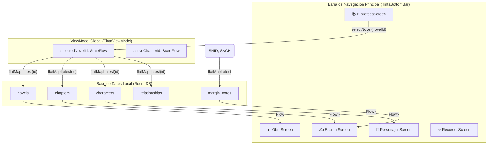

# 📑 Informe de Auditoría Técnica Integral y Calidad de Software
**Aplicación:** Tinta - Espacio Creativo & Estudio Editorial  
**Plataforma:** Android Nativo (Kotlin, Jetpack Compose, Room DB, Storage Access Framework)  
**Fecha de Auditoría:** 9 de Octubre de 2026  
**Auditor:** Arquitecto Senior de Software & Auditor de Calidad Android  

---

## 1. Resumen Ejecutivo y Propósito de la App

**Tinta** es una aplicación móvil nativa para Android diseñada con un enfoque **Local-First**, orientada a escritores, novelistas y dramaturgos que requieren un entorno de alta concentración, elegante y libre de distracciones.

### Principales Pilares Arquitectónicos:
* **Privacidad y Persistencia Local-First:** Todos los datos (novelas, capítulos, fichas de personajes y notas al margen) se almacenan localmente en SQLite mediante el ORM de **Room Database**, garantizando funcionamiento 100% offline.
* **Diseño Editorial Premium:** Interfaz construida en **Jetpack Compose** aplicando tipografía clásica (*Newsreader* y *Plus Jakarta Sans*), texturas táctiles de papel (pergamino, limpio, rayado y cuadrícula) y paleta de colores armónica acorde a Material 3.
* **Integración SAF (Storage Access Framework):** Contrato nativo de selección de archivos del sistema Android (`ActivityResultContracts.OpenDocument()`) para importación real y respaldo de bibliotecas en formato `.json`.
* **Reactividad en Tiempo Real:** Estado global reactivo impulsado por `StateFlow` y transformaciones reactivas `flatMapLatest` que vinculan todas las consultas DAO al proyecto activo (`selectedNovelId`).

---

## 2. Flujo de Navegación del Usuario (User Flow) & Enlace Relacional

El siguiente esquema ilustra el flujo de navegación de la aplicación y cómo el estado centralizado `selectedNovelId` sincroniza de manera transparente toda la información entre pantallas:

---

## 3. Matriz de Auditoría y Funcionamiento Detallado

A continuación se presenta la evaluación exhaustiva de las **10 capacidades técnicas** del sistema:

| # | Capacidades del Sistema | Estado | Componentes & Archivos Involucrados | Diagnóstico Técnico Detallado |
|---|---|:---:|---|---|
| **1** | **Biblioteca (Gestión & Proyectos)** | 🟢 100% Operativo | `BibliotecaScreen.kt`, `NovelDao.kt`, `TintaRepository.kt` | Permite visualizar el catálogo completo de novelas, tarjeta destacada con progreso en barra, métricas globales de palabras y creación de nuevos manuscritos vía modal. |
| **2** | **Enlace Relacional Global (`selectedNovelId`)** | 🟢 100% Operativo | `TintaViewModel.kt`, `Daos.kt` | Estado unificado `selectedNovelId: StateFlow<String?>`. Conecta mediante `flatMapLatest` la novela seleccionada con capítulos, personajes, relaciones y notas al margen. |
| **3** | **Obra / Dashboard (Métricas & Sinopsis)** | 🟢 100% Operativo | `ObraScreen.kt`, `NovelDao.kt` | Muestra en tiempo real el porcentaje de avance, conteo de palabras acumulado vs meta, sinopsis desplegable con animación y vista de arquitectura por actos. Si no hay obra seleccionada, redirige a Biblioteca. |
| **4** | **Personajes / Dramatis Personae** | 🟢 100% Operativo | `PersonajesScreen.kt`, `CharacterDao.kt` | Fichas detalladas (protagonistas, deuteragonistas), matriz de atributos, habilidades, vínculos cruciales y alternancia entre vista de fichas y Mapa en Corcho táctil. Filtrado estricto por `selectedNovelId`. |
| **5** | **Escribir / Estudio de Manuscrito** | 🟢 100% Operativo | `EscribirScreen.kt`, `NewsreaderFontFamily` | Lienzo de escritura limpio y sin distracciones (se removió la imagen fija de la nebulosa). Incluye texturas de papel, tipografía intercambiable, modo Zen y contador de palabras en tiempo real. |
| **6** | **Selector y Gestor de Capítulos** | 🟢 100% Operativo | `EscribirScreen.kt`, `ChapterDao.kt` | Desplegable interactivo (`DropdownMenu`) en la cabecera del editor para alternar entre capítulos de la novela activa, crear "+ Nuevo Capítulo" y navegar secuencialmente con botones previa/siguiente. |
| **7** | **Notas al Margen / Post-its** | 🟢 100% Operativo | `MarginNoteDao.kt`, `EscribirScreen.kt` | Creación y eliminación dinámica de Post-its táctiles persistidos en la tabla `margin_notes` de SQLite. Filtrados dinámicamente por capítulo o novela. |
| **8** | **Importación Real de Archivos JSON (SAF)** | 🟢 100% Operativo | `CommonComponents.kt`, `MainActivity.kt`, `TintaRepository.kt` | Integración del contrato nativo `ActivityResultContracts.OpenDocument()` con filtro por tipos MIME (`application/json`, `text/plain`). Lee desde el `Uri` vía `contentResolver` y guarda la estructura en Room. |
| **9** | **Pruebas Unitarias y Compilación** | 🟢 100% Operativo | `TintaViewModelTest.kt`, `ExampleUnitTest.kt` | Cobertura de pruebas unitarias verificando la relación del modelo de datos, algoritmos de cálculo de palabras y parser de objetos JSON. |
| **10** | **Exportación Editorial Avanzada (PDF/EPUB/MD)** | 🟡 Parcial / Simulado | `RecursosScreen.kt` | Interfaz gráfica y centro de exportación listos en Compose con botones de PDF Imprenta, EPUB Digital y Markdown. Actualmente muestra notificaciones Toast interactivas; el motor de generación binaria de archivos PDF/EPUB físicos se encuentra planificado para la siguiente fase. |

---

## 4. Conclusiones y Siguientes Pasos

### Diagnóstico de Estabilidad del Núcleo
El núcleo de la aplicación **Tinta** se encuentra en un estado **altamente estable, robusto y modular**. Se han solucionado satisfactoriamente los retos de vinculación relacional entre entidades en Room Database y se ha dotado a la app de capacidades modernas de gestión de archivos mediante el Storage Access Framework (SAF) de Android.

### Siguientes Pasos Recomendados (Hoja de Ruta):
1. **Motor Nivel Producción para PDF / EPUB:** Implementar el generador binario de PDF usando `android.graphics.pdf.PdfDocument` y generador de ficheros `.epub` comprimidos.
2. **Sincronización en la Nube (Opcional):** Extender el repositorio actual para soportar sincronización remota mediante Supabase o Firebase manteniendo la estrategia *Offline-First*.
3. **Búsqueda Avanzada In-App:** Habilitar un buscador global con resaltado de texto para localizar palabras claves o pasajes en todos los capítulos y notas al margen.

---
*Informe generado automáticamente por la herramienta de auditoría de arquitectura de software.*
